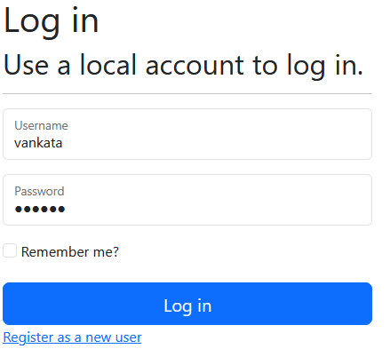
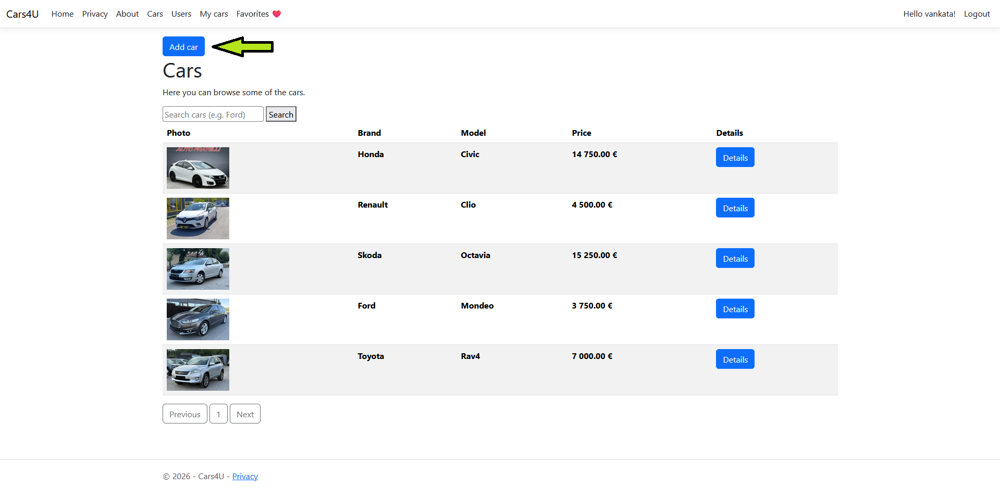
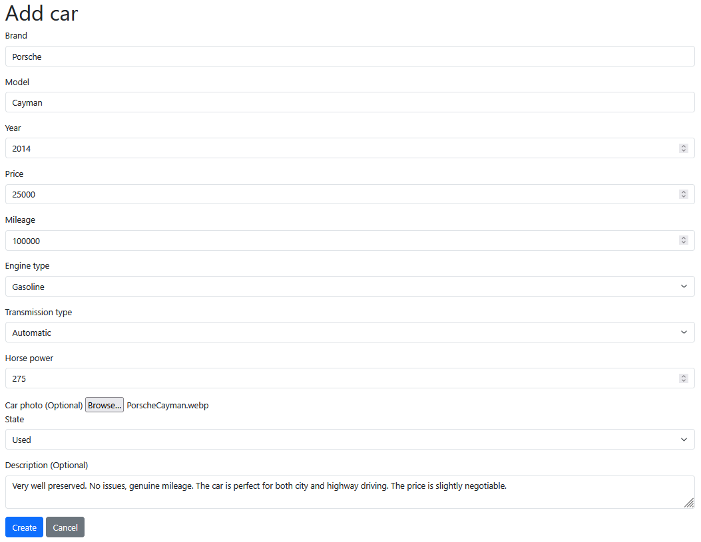
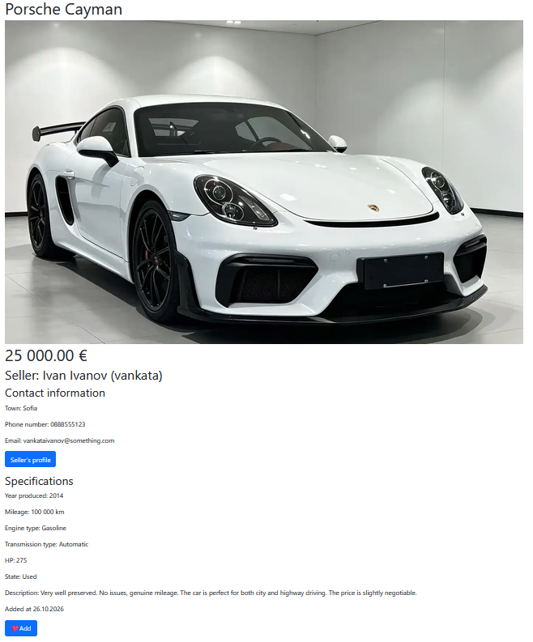
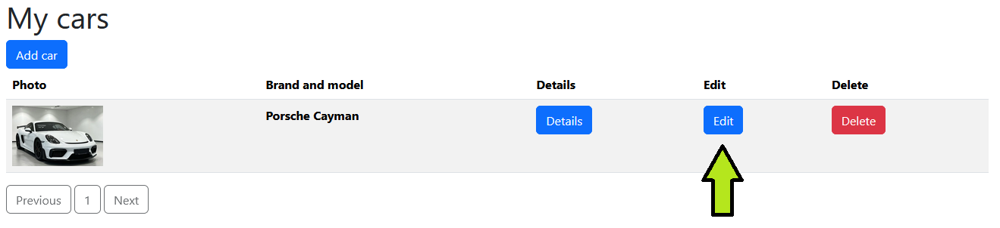
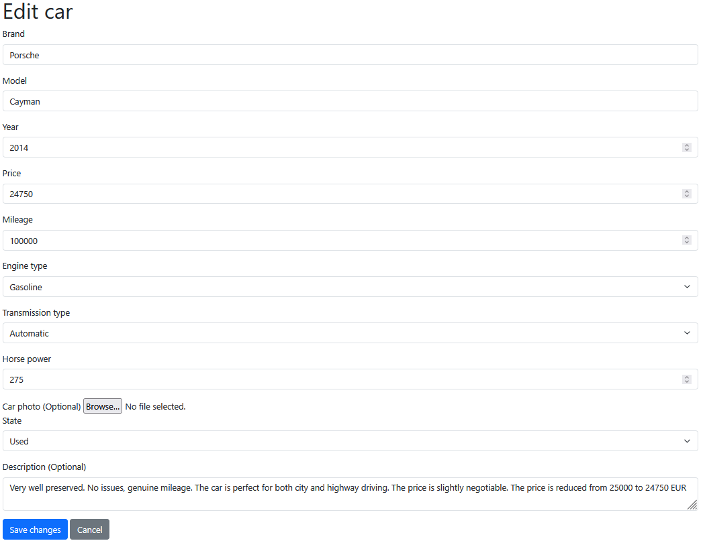
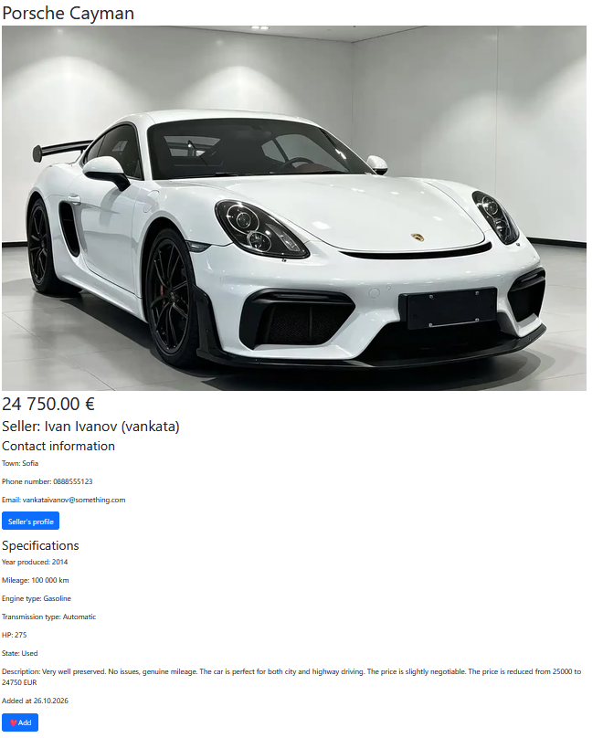
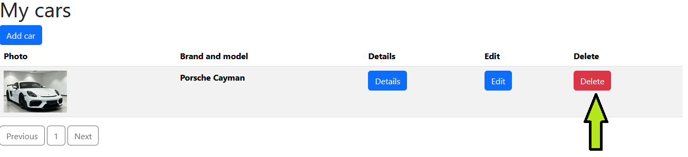
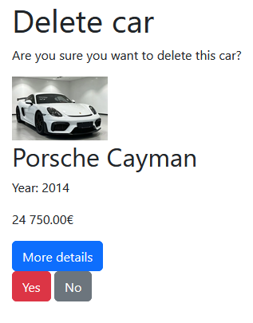

How to login  

```
1. Go to Login.
2. Type your username and password.
3. Click "Login".
```

How to add a car  
  
  
  

```
1. Make sure you are logged in.
2. Go to Cars or My cars.
3. Click "Add car".
4. Type your information about the car.
5. Click "Add".
```


  


How to edit a car
1. Make sure you are logged in.
2. Go to My cars.
3. Click "Edit" on the car you want to edit.
4. Edit some of the fields.
5. Click "Save changes".
```




How to delete a car
```
1. Make sure you are logged in.
2. Go to My cars.
3. Click "Delete" on the car you want to delete.
4. On the confirmation page click on "Yes"
```


## 🗄️ Database Setup

The project uses **Entity Framework Core** with a Code-First approach.

Connection string is configured in `appsettings.json`:

```json
"ConnectionStrings": {
  "DefaultConnection": "Server=.;Database=Cars4U;Trusted_Connection=True;Encrypt=false"
}
```

To create and seed the database:

```bash
dotnet ef migrations add InitialCreate
dotnet ef database update
```

---

## ⚙️ Configuration

Key settings in `appsettings.json`:

```json
{
  "ConnectionStrings": {
    "DefaultConnection": "Server=.;Database=Cars4U;Trusted_Connection=True;Encrypt=false"
  },
  "Logging": {
    "LogLevel": {
      "Default": "Information",
      "Microsoft.AspNetCore": "Warning"
    }
  },
  "AllowedHosts": "*"
}
```


## 🤝 Contributing

Contributions are welcome! To contribute:

1. Fork the repository
2. Create a new branch: `git checkout -b feature/your-feature-name`
3. Commit your changes: `git commit -m "Add some feature"`
4. Push to the branch: `git push origin feature/your-feature-name`
5. Open a Pull Request

---

## 📄 License

This project is licensed under the **MIT License**. See the [LICENSE](LICENSE) file for details.

---

## 📬 Contact

**Your Name** – [ackodavidoff-png](https://github.com/ackodavidoff-png/)

Project Link: [https://github.com/ackodavidoff-png/Cars4U](https://github.com/ackodavidoff-png/Cars4U)

---

*Built as part of the **ASP.NET Fundamentals** course.*
