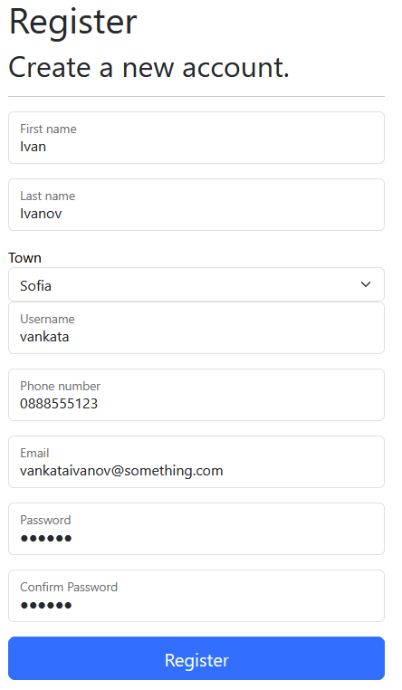

# 🚀 Cars4U


---

## 📋 Table of Contents

- [About the Project](#about-the-project)
- [Technologies Used](#technologies-used)
- [Prerequisites](#prerequisites)
- [Getting Started](#getting-started)
- [Project Structure](#project-structure)
- [Features](#features)
- [Usage](#usage)
- [Database Setup](#database-setup)
- [Configuration](#configuration)
- [Contributing](#contributing)
- [License](#license)
- [Contact](#contact)

---

## 📖 About the Project

Cars4U is a web-based application, built as part of the *ASP.NET Fundamentals* course, using the ASP.NET technology, MVC architecture and Entity Framework technology. Cars4U is a car selling platform, similar to a famous bulgarian car selling platform. In Cars4U users can be registered in the machine local SQL database server.  


---

## 🛠️ Technologies Used

| Technology            | Version  | Purpose                          |
|-----------------------|----------|----------------------------------|
| ASP.NET Core MVC      | 10.0     | Web framework                    |
| Entity Framework Core | 10.0     | ORM / Database access            |
| Transact SQL          | 22       | Database                         |
| Bootstrap             | 5.3      | Frontend styling                 |
| Razor Pages / Views   | -        | Server-side HTML rendering       |

---

## ✅ Prerequisites

Make sure you have the following installed before running the project:

- [.NET SDK 8.0+](https://dotnet.microsoft.com/download)
- [Visual Studio 2022](https://visualstudio.microsoft.com/) or [VS Code](https://code.visualstudio.com/)
- [SQL Server](https://www.microsoft.com/en-us/sql-server) or SQLite (if used)
- [Git](https://git-scm.com/)

---

## 🚀 Getting Started

Follow these steps to get the project running locally.

### 1. Clone the repository

```bash
git clone https://github.com/ackodavidoff-png/Cars4U.git
cd Cars4U
```

### 2. Restore dependencies

```bash
dotnet restore
```

### 3. Apply database migrations

```bash
dotnet ef database update
```

### 4. Run the application

```bash
dotnet run
```

The app will be available at `https://localhost:5001` or `http://localhost:5000`.

---

## 📁 Project Structure

```
WebApplication1/
│
├── Areas/                    # Code for Identity
├── Controllers/              # MVC Controllers
├── Properties/               # Json information about the project
├── SQLQueries/               # Helpful SQL queries
├── Views/                    # Razor Views (.cshtml)
├── wwwroot/                  # Static files (CSS, JS, images)
├── appsettings.json          # App configuration
└── Program.cs                # App entry point and middleware setup

WebApplication1.Data
|
├── Configuration/
│   │
│   ├── Favorites/            # Configuration for favorites in DbContext
│   └── Towns/                # Configuration for towns in DbContext
├── Migrations/               # Contains information about the migrations in DbContext
└── ApplicationDbContext.cs   # Application Database context

WebApplication1.Data.Models/
│
├── Enums/                    # Contains enumerations in the Database
├── ApplicationUser.cs        # Contains properties about the application user
├── Car.cs                    # Contains properties about the car
├── Favorite.cs               # Contains properties about the avorites
└── Town.cs                   # Contains properties about the towns

WebApplication1.GCommon/
│
├── ApplicationConstraints.cs # Constraints for the application
├── EntityConstraints.cs      # Constraints for the entities in the database
├── Error messages.cs         # Error messages for the application
├── IdentityConstants.cs      # Constants for identity
└── PaginatedList.cs          # An enumerable for paginations

WebApplication1.Services/     #Business logic / service layer
│
├── Core/                     # Interfaces for the services
├── CarService.cs             # Car service
└── FavoriteService.cs        # Favorites service

WebApplication1.ViewModels/   # ViewModels
```

---

## ✨ Features

- [ ] User registration and login (ASP.NET Identity)
- [ ] Create car (Login required)
- [ ] Preview car
- [ ] Edit car (Login required)
- [ ] Delete car (Login required)
- [ ] RESTful API endpoints
- [ ] Input validation (server-side & client-side)
- [ ] Responsive UI with Bootstrap

---

## 💻 Usage

Describe how to use the main features of the app after launching it. Add screenshots if possible.
How to register  

```
1. Go to Register.
2. Type your firstname, last name, username, town, password, then confirm your password.
3. Click "Register".
```

How to login  

```
1. Go to Login.
2. Type your username and password.
3. Click "Login".
```

How to add a car  
  
  
  

```
1. Make sure you are logged in.
2. Go to Cars or My cars.
3. Click "Add car".
4. Type your information about the car.
5. Click "Add".
```


  


How to edit a car
```
1. Make sure you are logged in.
2. Go to My cars.
3. Click "Edit" on the car you want to edit.
4. Edit some of the fields.
5. Click "Save changes".
```


How to delete a car
```
1. Make sure you are logged in.
2. Go to My cars.
3. Click "Delete" on the car you want to delete.
4. On the confirmation page click on "Yes"
```


## 🗄️ Database Setup

The project uses **Entity Framework Core** with a Code-First approach.

Connection string is configured in `appsettings.json`:

```json
"ConnectionStrings": {
  "DefaultConnection": "Server=(localdb)\\MSSQLLocalDB;Database=Cars4U;Trusted_Connection=True;Encrypt=false"
}
```

To create and seed the database:

```bash
dotnet ef migrations add InitialCreate
dotnet ef database update
```

---

## ⚙️ Configuration

Key settings in `appsettings.json`:

```json
{
  "ConnectionStrings": {
    "DefaultConnection": "Server=(localdb)\\MSSQLLocalDB;Database=Cars4U;Trusted_Connection=True;Encrypt=false"
  },
  "Logging": {
    "LogLevel": {
      "Default": "Information",
      "Microsoft.AspNetCore": "Warning"
    }
  },
  "AllowedHosts": "*"
}
```

**Important:** If the default connection string does not work, go to the `appsettings.json` and change the server name to your local database SQL server.

## 🤝 Contributing

Contributions are welcome! To contribute:

1. Fork the repository
2. Create a new branch: `git checkout -b feature/your-feature-name`
3. Commit your changes: `git commit -m "Add some feature"`
4. Push to the branch: `git push origin feature/your-feature-name`
5. Open a Pull Request

---

## 📄 License

This project is licensed under the **MIT License**.

---

## 📬 Contact

**Your Name** – [ackodavidoff-png]((https://github.com/ackodavidoff-png/)

Project Link: [https://github.com/ackodavidoff-png/Cars4U](https://github.com/ackodavidoff-png/Cars4U)

---

*Built as part of the **ASP.NET Fundamentals** course.*
